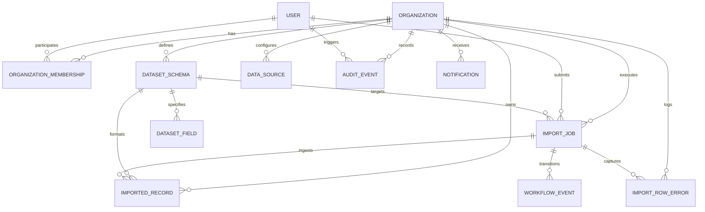

# Nexora Database Schema & Relational Design

## 1. Architectural Strategy

Nexora utilizes a normalized relational schema backed by PostgreSQL. Primary keys are either UUIDs or auto-incrementing BigInts depending on access patterns and external API exposure. Timezone-aware UTC timestamps (`created_at`, `updated_at`) are maintained across all entities.

---

## 2. Entity Relational Model

---

## 3. Schema Specifications

### `accounts_user`
- `id` (UUID, PK)
- `email` (VarChar 255, Unique, Indexed)
- `first_name` (VarChar 150)
- `last_name` (VarChar 150)
- `is_active` (Boolean, Default True)
- `is_staff` (Boolean, Default False)
- `is_platform_admin` (Boolean, Default False)
- `date_joined` (DateTime UTC)

### `organizations_organization`
- `id` (UUID, PK)
- `name` (VarChar 200)
- `slug` (SlugField 220, Unique, Indexed)
- `description` (TextField, Blank)
- `timezone` (VarChar 50, Default 'UTC')
- `is_active` (Boolean, Default True)
- `created_at` (DateTime UTC)
- `updated_at` (DateTime UTC)

### `organizations_organizationmembership`
- `id` (UUID, PK)
- `organization_id` (FK -> Organization, on_delete=CASCADE)
- `user_id` (FK -> User, on_delete=CASCADE)
- `role` (VarChar 30: `org_admin`, `operator`, `analyst`, `viewer`)
- `is_active` (Boolean, Default True)
- `joined_at` (DateTime UTC)
- **Constraint:** Unique(`organization_id`, `user_id`)

### `schemas_datasetschema`
- `id` (UUID, PK)
- `organization_id` (FK -> Organization, on_delete=CASCADE, Indexed)
- `name` (VarChar 200)
- `slug` (SlugField 220)
- `description` (TextField, Blank)
- `version` (PositiveInteger, Default 1)
- `status` (VarChar 20: `draft`, `active`, `deprecated`)
- `created_by_id` (FK -> User, on_delete=SET_NULL, Nullable)
- `created_at` (DateTime UTC)
- `updated_at` (DateTime UTC)
- **Constraint:** Unique(`organization_id`, `slug`, `version`)

### `schemas_datasetfield`
- `id` (UUID, PK)
- `dataset_schema_id` (FK -> DatasetSchema, on_delete=CASCADE, Indexed)
- `field_name` (VarChar 100)
- `display_name` (VarChar 150)
- `field_type` (VarChar 30: `string`, `integer`, `decimal`, `boolean`, `date`, `datetime`, `email`)
- `is_required` (Boolean, Default False)
- `is_unique` (Boolean, Default False)
- `default_value` (VarChar 255, Blank, Nullable)
- `validation_rules` (JSONField, Default Dict)
- `position` (PositiveInteger, Default 0)
- **Constraint:** Unique(`dataset_schema_id`, `field_name`)

### `datasources_datasource`
- `id` (UUID, PK)
- `organization_id` (FK -> Organization, on_delete=CASCADE, Indexed)
- `name` (VarChar 200)
- `source_type` (VarChar 50: `file_upload`, `sftp`, `webhook`)
- `description` (TextField, Blank)
- `configuration` (JSONField, Default Dict)
- `is_active` (Boolean, Default True)
- `created_by_id` (FK -> User, on_delete=SET_NULL, Nullable)
- `created_at` (DateTime UTC)
- `updated_at` (DateTime UTC)

### `ingestion_importjob`
- `id` (UUID, PK)
- `organization_id` (FK -> Organization, on_delete=CASCADE, Indexed)
- `dataset_schema_id` (FK -> DatasetSchema, on_delete=PROTECT, Indexed)
- `schema_version` (PositiveInteger)
- `data_source_id` (FK -> DataSource, on_delete=SET_NULL, Nullable)
- `created_by_id` (FK -> User, on_delete=SET_NULL, Nullable)
- `file_name` (VarChar 255)
- `file_size` (BigInteger)
- `checksum` (VarChar 64, Indexed) - SHA-256
- `idempotency_key` (VarChar 128, Nullable, Indexed)
- `status` (VarChar 30: `queued`, `processing`, `completed`, `completed_with_errors`, `failed`, `cancelled`)
- `total_rows` (PositiveInteger, Default 0)
- `processed_rows` (PositiveInteger, Default 0)
- `successful_rows` (PositiveInteger, Default 0)
- `failed_rows` (PositiveInteger, Default 0)
- `started_at` (DateTime UTC, Nullable)
- `completed_at` (DateTime UTC, Nullable)
- `error_summary` (TextField, Blank)
- `created_at` (DateTime UTC)
- `updated_at` (DateTime UTC)

### `records_importedrecord`
- `id` (UUID, PK)
- `organization_id` (FK -> Organization, on_delete=CASCADE, Indexed)
- `dataset_schema_id` (FK -> DatasetSchema, on_delete=PROTECT, Indexed)
- `source_job_id` (FK -> ImportJob, on_delete=CASCADE, Indexed)
- `source_row_number` (PositiveInteger)
- `external_id` (VarChar 255, Nullable, Indexed)
- `payload` (JSONB / JSONField)
- `record_hash` (VarChar 64, Indexed)
- `created_at` (DateTime UTC)
- `updated_at` (DateTime UTC)
- **Constraint / Index:** Index on (`organization_id`, `dataset_schema_id`, `external_id`)

### `ingestion_importrowerror`
- `id` (UUID, PK)
- `organization_id` (FK -> Organization, on_delete=CASCADE, Indexed)
- `import_job_id` (FK -> ImportJob, on_delete=CASCADE, Indexed)
- `row_number` (PositiveInteger)
- `field_name` (VarChar 100, Blank)
- `error_code` (VarChar 50)
- `error_message` (TextField)
- `created_at` (DateTime UTC)

### `workflows_workflowevent`
- `id` (UUID, PK)
- `organization_id` (FK -> Organization, on_delete=CASCADE, Indexed)
- `import_job_id` (FK -> ImportJob, on_delete=CASCADE, Indexed)
- `event_type` (VarChar 50)
- `previous_state` (VarChar 30)
- `new_state` (VarChar 30)
- `metadata` (JSONField, Default Dict)
- `created_at` (DateTime UTC)

### `audit_auditevent`
- `id` (UUID, PK)
- `organization_id` (FK -> Organization, on_delete=CASCADE, Nullable, Indexed)
- `actor_id` (FK -> User, on_delete=SET_NULL, Nullable)
- `action` (VarChar 100)
- `resource_type` (VarChar 100)
- `resource_id` (VarChar 100)
- `request_id` (VarChar 64, Blank, Indexed)
- `metadata` (JSONField, Default Dict)
- `created_at` (DateTime UTC)

### `notifications_notification`
- `id` (UUID, PK)
- `organization_id` (FK -> Organization, on_delete=CASCADE, Indexed)
- `user_id` (FK -> User, on_delete=CASCADE, Nullable, Indexed)
- `title` (VarChar 255)
- `message` (TextField)
- `notification_type` (VarChar 50: `job_success`, `job_failed`, `schema_change`, `security_alert`)
- `is_read` (Boolean, Default False)
- `link` (VarChar 255, Blank)
- `created_at` (DateTime UTC)
